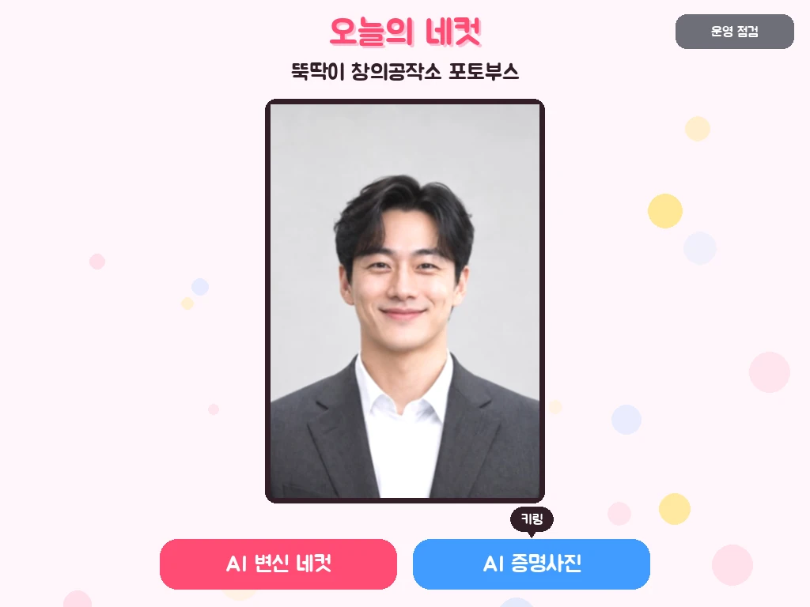
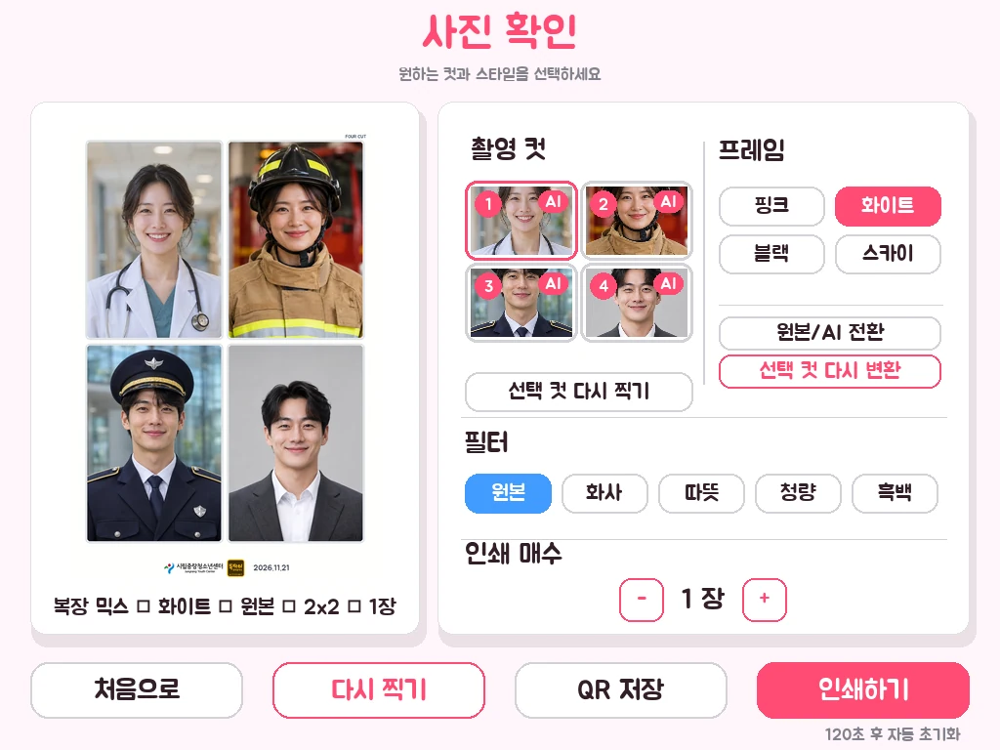
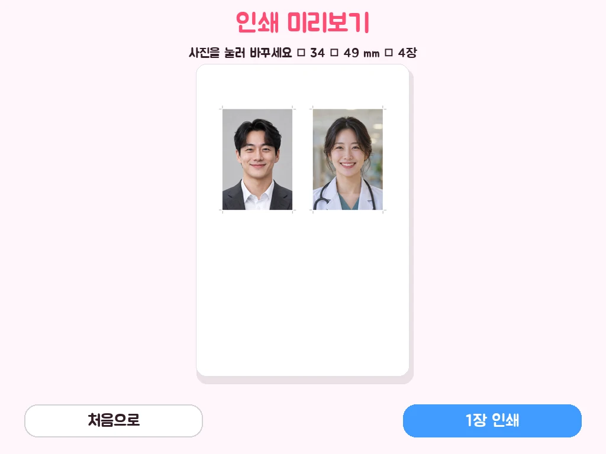

# 뚝딱 포토부스

시립중랑청소년센터 **뚝딱이 창의공작소**의 행사 포토부스입니다. Raspberry Pi 5에서 마우스로 복장을 고르고 촬영한 뒤, Canon SELPHY CP1500으로 출력할 수 있습니다. 설치를 마치면 라즈베리파이에서 독립적으로 운영합니다.

[라즈베리파이 설치 순서](RASPBERRY_PI5_SETUP.md) · [단계별 화면 안내](docs/SCREEN_GUIDE.md) · [문제 해결](RASPBERRY_PI5_SETUP.md#문제-해결)



## 두 가지 촬영 모드

| 모드 | 이용 순서 | 결과 |
| --- | --- | --- |
| **AI 변신 네컷** | 복장 1~4개 선택 → 동의 → 네 컷 연속 촬영 → 결과 확인 | 2×2 네컷 한 장. 컷별 합성이 촬영과 동시에 진행되고, 결과 화면에서 컷별 재촬영·재변환과 프레임·필터 선택이 가능합니다. 인쇄하거나 QR로 저장할 수 있습니다. |
| **키링용 AI 증명사진** | 1~4명 선택 → 복장 1~4개 선택 → 한 명씩 동의·촬영 → 인쇄 칸 확인 | 한 장에 최대 네 칸. 각 사진은 **가로 34 × 세로 49 mm**이며, 칸을 눌러 사진을 바꿀 수 있습니다. |

네 칸에 복장을 배정할 때 **1개는 네 컷 모두 같은 복장**, **2개는 두 컷씩**, **3개는 한 컷씩과 무작위 한 컷**, **4개는 한 컷씩**입니다. 배정 순서는 무작위입니다. 키링 모드에서 여러 사람이 복장 하나를 고르면 각자 한 칸씩 배치합니다.

| 네컷 결과 확인 | 키링 인쇄 미리보기 |
| --- | --- |
|  |  |

## 설치와 운영

1. **장치 연결** · HDMI 모니터와 USB 웹캠·마우스를 Pi에 연결합니다. CP1500은 USB-C 데이터 케이블로 연결하고 별도 전원을 꽂습니다. 키보드는 초기 설정에 사용합니다.
2. **프로그램 설치** · Raspberry Pi OS 64-bit Desktop에서 저장소를 내려받고 `./install.sh`를 실행합니다.
3. **AI와 프린터 설정** · `.env`에 MonoRouter 키를 넣고 CUPS에 CP1500을 등록합니다.
4. **현장 점검** · `venv/bin/python doctor.py`로 점검하고 시험 인쇄를 합니다. 바탕화면의 **포토부스 실행** 아이콘으로 시작합니다.

명령어와 설정값은 [라즈베리파이 설치 안내](RASPBERRY_PI5_SETUP.md)에 순서대로 정리했습니다. QR 저장은 휴대폰이 라즈베리파이와 통신할 수 있는 같은 로컬 Wi-Fi에서 사용할 수 있습니다.

## 맥북에서 화면 체험

Python 3.12가 설치된 맥북에서 실행합니다.

```bash
git clone https://github.com/koreadeveloper/Ddukddak_Workshop_Phtobooth.git photobooth
cd photobooth
python3.12 -m venv venv
venv/bin/python -m pip install -r requirements.txt
./run.sh --test --window --ai-mock --no-audio
```

테스트 모드는 가상 카메라와 모의 AI를 사용합니다. 키가 필요 없으며, 프린터 없이 화면을 둘러볼 때는 사진 확인 화면까지 진행하세요. `Esc`로 앱을 닫습니다. 화면 안내의 캡처는 맥북에서 이 앱을 실행하고 저장소의 예시 사진과 모의 인쇄를 사용해 만들었습니다.

[전체 17개 화면 보기](docs/SCREEN_GUIDE.md) · [개발 인수인계](DEVELOPMENT_HANDOFF.md)
